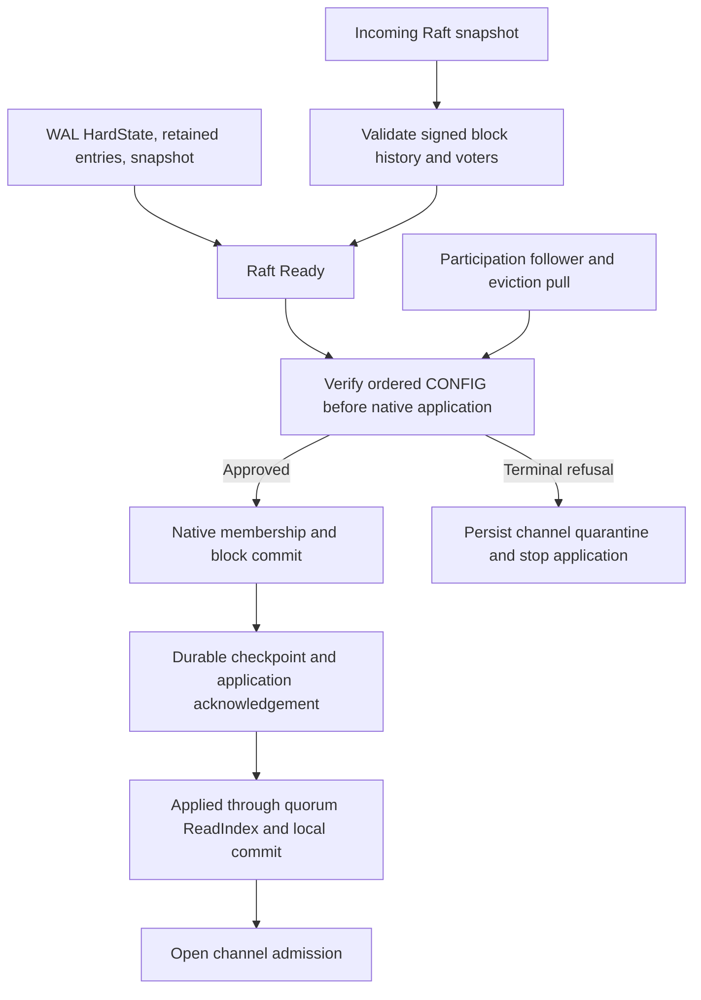

# ADR: PQ transport policy and Fabric configuration activation

PQ4.0E authenticates channel selection before managed startup. Protected
services consume the activation generation and hold it through the relevant
handoff or response. Shared roots and Gateway endpoints publish after staged
validation and cache retirement. The service inventory and deployment
boundary are tracked in [PQ4.0E status](pq4.0e-status.md).

**Status: proposed for architecture review. PQ4.0B enforcement remains INCOMPLETE.**

## Decision and alternatives

Use staged serving resources and a channel admission fence. A private commit path
may use the candidate only for Fabric validation and native commit bookkeeping.
External requests and background consumers enter through the active generation.
PQ4.0C exercised this design through Linux test adapters. PQ4.0D wires
the local authorization store into the orderer Raft and participation lifecycle.

| Approach | Fabric constraints |
| --- | --- |
| Stage every update until after commit | The peer's config-only transaction can validate against the prior bundle and leave callbacks pending. On the orderer, moving `support.Update` would change the sequence read by `addLastConfig`. A full staged design would need an explicit candidate metadata input and a review of signing and consensus side effects. |
| Fence around existing public update | Keeps native ordering, but a fence on channel lookup does not protect synchronous callbacks, cached policy references, shared TLS trust pools and cluster dialers. Those could observe changes before commit. |
| Selected hybrid | Keep private writer support for native orderer sequence, last-config metadata and signing. Stage operational callbacks on both roles. Release the fence only after the ledger is durable, the checkpoint advances and the serving generation is complete. |

## Write-ahead protocol

```text
startup -> RECOVERY_REQUIRED -> ACTIVE(previous | candidate)
                            \-> QUARANTINED

ACTIVE(previous) -> PREPARED -> COMMIT_PENDING -> ACTIVE(candidate)
                       |              |
                       +--> recovery <-+
```

- **ACTIVE.** The authenticated checkpoint matches the exact committed
  configuration, the bundle and its dependent resources are installed, and
  admissions have opened. An initial channel binding is independently
  provisioned. A mismatch closes admission even if the preceding config could
  otherwise serve.
- **PREPARED.** Verify Fabric authorization using the previous config's
  validator and compatibility checks. Independently verify the ML-DSA operator
  transition and the signed replacement policy with `VerifyOperatorTransition`.
  Sync the record before entering native commit. The signed records bind
  network, node, channel, both checkpoint versions and digests, exact next
  config sequence and deterministic digest, and `pactway-pq-tls-v1`. The
  journal records prior and candidate block numbers and header hashes. A header
  hash binds the previous hash and data hash, and the proof checks the actual
  config block data before using that identity. Block signatures are generated
  by the native writer and are outside the transition digest.
- **COMMIT_PENDING.** Close admission, cancel and drain the old generation,
  persist commit intent, then invoke Fabric commit. Confirm that the latest
  committed config is the exact recorded block and sync the block-file
  directory before replacing the checkpoint. An error after entry leaves the
  gate closed. Never infer commit outcome from the return value alone.
- **Publication.** Replace the checkpoint and signed policy together. Run the
  serving publication callbacks while the gate is closed. Sync the completed
  journal before opening the new generation. Publication after restart must
  rebuild local derived state idempotently. Callback failure leaves the gate
  closed and can be retried from the recovered state.
- **RECOVERY_REQUIRED.** Every fresh process begins closed. Open Fabric stores
  and recover their indexes and state DB before inspecting the latest config.
  Orderers also need a native Raft apply/replay barrier. When the old ledger
  config and checkpoint match and the candidate block position is absent,
  persist `ABORTED` and resume the previous generation. When the candidate
  block matches a commit-pending record, revalidate both authorizations against
  the recorded predecessor. Advance only from the exact old checkpoint. If the
  new checkpoint already exists, authenticate it and complete publication.
- **QUARANTINED.** Persist a per-channel marker for an unauthorized committed
  config, conflicting identities, or invalid recovery state. A configured node
  may stop participating on a channel whose network has legitimately advanced.
  Preserve its ledger and the consensus decision. Treat a corrupt or missing
  node-wide checkpoint as a readiness failure for every bound channel. Operator
  remediation is outside this proof and no automatic path clears a quarantine.

The selected local store uses one owning process and one node-wide transition
writer because one bootstrap policy versions all channel bindings. The proof
requires a private, operator-provisioned directory on a local Linux filesystem.
Create a same-directory mode-0600 temporary file, write, sync and close it,
rename over the target, and sync the directory. Ignore unfinished temporary
files during recovery. A crash can leave either whole version around rename.
Independently reconcile the ledger, journal and checkpoint. Existing Fabric
block storage syncs block contents. The adapter also syncs the channel
block-file directory, including when a new block file is created by rotation.
Durability of freshly provisioned directory ancestors is a provisioning
requirement. The process-loss tests do not reproduce power loss or prove storage
behavior under a privileged host rollback.

## Native interception points

### Peer

`gossip/state` hands blocks to `gossip/privdata.coordinator.StoreBlock` for
validation and commit. The V14 and V20 validation routers call `Channel.Apply`
for a config transaction. That method validates, builds a bundle and calls
`BundleSource.Update`. The bundle pointer is swapped before callbacks, and
`applyLock` ends before ledger commit. The `LedgerCommitter.CommitLegacy`
post-commit callback runs after the peer ledger returns.

The focused test runs the V20 validator with a private `Channel.Apply`, commits
through the real committer and kvledger, and publishes a separate serving
`BundleSource`. Its post-commit callback observes the old serving bundle. On
reopen it compares `ConfigBlockFromLedger` with
`RetrievePersistedChannelConfig` before publication. Node integration must
capture config block identity at `StoreBlock`, defer the real gossip, TLS
roots, MSP registration and lifecycle callbacks, and contain failures before
`Peer.createChannel` creates serving resources or inserts the channel. Check
the provisioned binding and native admin authorization at genesis join. A
snapshot join stays closed when the expected committed block or provenance
cannot be established.

The PQ4.0E.2 peer snapshot path additionally requires a v2 operator anchor
bound to authenticated exporter evidence and an exact staged file inventory.
The exporter proof is retained with protected state and revalidated alongside
the native snapshot metadata and ledger boundary during restart; missing or
conflicting evidence is a recovery failure, not a reason to fall back to
baseline admission. Legacy v1 peer snapshot anchors are rejected.

### Orderer

`StandardChannel.ProcessConfigUpdateMsg` establishes Fabric authorization
before submission. Recheck local approval at the proposal boundary using the
current sequence and again for the concrete block at apply. For both Raft
leaders and followers, `etcdraft.Chain.apply` routes ordered config blocks
through `writeConfigBlock`. Catch-up uses `commitBlock`. Participation
followers in `follower.Chain.pullUntilTarget` append directly and then use the
config for verification, endpoints and membership. Registrar initialization,
join and both role switches must carry the same gate across chain objects.

The focused test uses the real `BlockWriter.WriteConfigBlock` with
`ChainSupport` backed by a private callback-free bundle. The writer waits for
any prior append, updates the private bundle, reads its sequence in
`addLastConfig`, signs through the native signer, and appends synchronously.
The proof verifies both representations of last-config, committed block
contents, the signature under the prior block-validation policy, and metadata
on the following normal block. In production, Raft also uses the candidate
for membership computation and updates its options before the block writer.
Fencing just `WriteConfigBlock` cannot cover that earlier mutation or
establish replay completion.

For an ordered config missing local approval, stop at the pre-apply boundary,
preserve the Raft WAL and keep the channel quarantined. Block signing is
allowed only in the Fabric commit lane for an approved candidate. Restart must
check already-decided Raft work even if the prior block and checkpoint match.
The current production `WriteConfigBlock` method cannot signal a channel-local
pause to its caller, and calling the synchronous `Halt` from the apply loop can
wait for that same loop. The smallest follow-on seam is a per-channel
pre-apply result before membership/options mutation that propagates a
quarantine decision to the Raft loop owner, plus a replay-completion signal
before normal admission. The separate participation follower needs an
equivalent guard before append and verifier publication. Review these seams
before changing consensus runtime or claiming leader/follower enforcement.

## PQ4.0D native orderer lifecycle



The protected orderer starts in recovery with admission closed. It uses WAL
commit state, native snapshots, the retained log tail, the ledger's Raft
indices, and a fresh quorum-confirmed Raft `ReadIndex` for the current
term and leader. A learner or partition without sufficient evidence stays
closed. Fabric syncs the protected commit watermark before application. The
Ready owner waits for a successful application result before advancing Raft.
The startup check is scoped to decisions covered by that read barrier and
work discovered in the local Raft lifecycle.

`General.PQActivation.Channels` is an isolated-development opt-in under the
trusted local bootstrap configuration assumption. Removing an entry selects
baseline behavior without consulting the channel's signed checkpoint. Before
deployment, protection selection must bind to signed bootstrap policy and
protected state, and the node must fail closed if its local selector disagrees.

The leader binds its staged operator approval to the exact proposal. Apply
rechecks the real config block, Fabric predecessor authorization, ledger tip,
policy version, signed transition, and the strict transport floor. The
application owner enters the native writer only after the authorization
record is durable. The writer retains responsibility for Fabric metadata
and signatures. Endpoint reconfiguration follows durable application.
Replayed membership entries use the voter IDs recorded by the signed
Fabric block preceding their Raft index, or the anchored genesis for initial
membership. A voter already present in Raft cannot authorize an addition.

Terminal refusal closes the generation and commits a channel-local marker.
The Raft owner stops before acknowledging the refused application.
The registrar reports failure and retains the channel's ledger, WAL, and
snapshots. Restart and role changes retain the marker. An interrupted
authorized write remains closed until the exact transition is reconciled.
Node-wide checkpoint corruption closes all channels bound to that store.
Protected WAL restore preserves unreadable evidence for diagnosis.
Best-effort delivery honors protected channel admission.

Protected snapshots require a verifiable block history, an exact match
between the signed block's Raft index and the snapshot index, and an
authenticated voter set at that boundary before installation. Missing or
conflicting voter evidence supplied by a peer leaves admission closed while later
verified snapshots or log replay can restore readiness. A persisted snapshot
that conflicts with the trusted local ledger at a verified boundary causes
quarantine. The bounded pull verifies up to 1,024
missing blocks per snapshot. Participation joins from a later block start
from the provisioned genesis anchor and verify forward before changing their
verifier or endpoints. Promotion to Raft requires the same replay barrier.

## PQ4.0E.1 join-history provenance

An operator signature on an orderer or peer join anchor approves the target;
it does not establish that the target belongs to an authorized Fabric history.
The provisioning helper replays every block from the genesis identity held by
the authenticated protected registry. It uses the preceding configuration's
native `BlockValidation` policy for each block, validates each configuration
transition under the preceding bundle, checks sequence and `LAST_CONFIG`
progression, and binds the resulting configuration digest to the local
authenticated Pactway checkpoint before allowing anchor signing.

The helper is separate from runtime admission and does not replace native
participation-follower membership, Raft replay, or peer snapshot checks. It
fails closed for unsupported boundaries and consensus metadata that cannot be
validated by the supported native Raft validator. The implementation and
operator flow are tracked in the
[PQ4.0E.1 provenance guide](pq4.0e1-provenance.md); acceptance, final-head
Linux CI and independent review remain pending. This work does not close PQ4.0B.

History verification authenticates the snapshot boundary, not the snapshot
state. The provisioner must independently trust the exporter and validate
the snapshot payload hashes before signing; import-time hash checks alone
cannot establish the authenticity of exported state.

## Admission and TLS

Use a generation lease at endorsement, Gateway, discovery, gossip, delivery
and private-data dispatch, and at orderer broadcast, deliver and cluster
dispatch. Recheck streaming operations per message and before sending. Cancel
old generations and wait for their leases to release before native commit.
Handlers must release their lease without needing the transition owner.
Close admission before taking Fabric resource or block writer locks. Callbacks
must never acquire a lease or wait for gated work. A raw stable bundle pointer
is immutable but does not confer a right to continue serving with it.

A listener can serve multiple channels before the handshake knows the channel.
Provision the strongest profile required by the local listener's channels and
hold that TLS minimum throughout transition and recovery. Channel admission
remains separate from TLS connection acceptance. Candidate roots, dialer
endpoints and caches stay private until approved publication. Changes to shared
resources must use an atomic approved snapshot and prevent candidate-channel
work from using prior connections or credentials. Other channels may keep
their leases for a non-weakening update with unchanged bindings and the same
listener floor. This PR does not wire these rules into the production RPC,
background work, listener or callback fan-out.

## Acceptance and next steps

The [gate report](pq4.0b-gate-report.md#pq40c-activation-proof) records evidence
and the crash matrix. The prototype leaves existing baseline and enrollment
capability behavior unchanged. Keep PQ4.0B enforcement INCOMPLETE pending the
following work after architecture review.

1. Integrate protected node bootstrap and native ledger/Raft recovery readiness.
   Wire peer and orderer admission and callback publication through the reviewed
   seams, and prove quarantine and recovery in a multi-node test.
2. Bind the reviewed contract to fresh genesis and channel participation before
   enabling or advertising the channel capability. Verify snapshot provenance,
   node authorization distribution, and compatibility with existing binaries.
3. Roll out the reviewed strict TLS profile across the listener and dialer paths,
   including shared resources and connection invalidation, and rerun full
   network and regression acceptance before progressing to PQ4.1.
